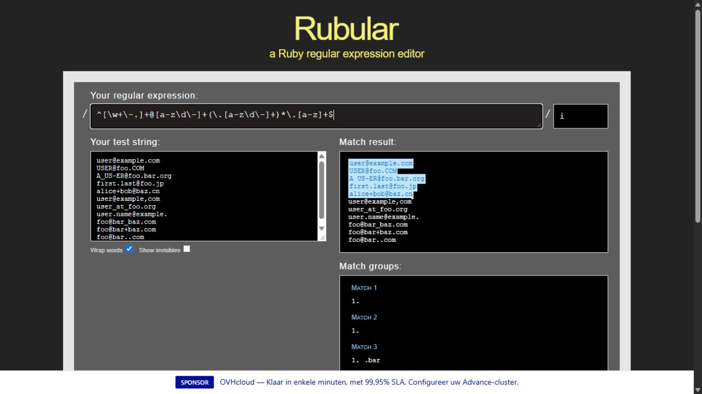

# Лабораторная работа 6 — Modeling Users

Основа: локальный web5. Сохраняем Rails 8.1.4 и Ruby 3.4.11 исходного приложения; миграции адаптированы к Rails 8.1. Все действия локальные. Результаты упражнений добавляются по этапам.

## 6.1.1–6.1.2. Модель и миграция

`CreateUsers` создаёт name, email и timestamps. `db/schema.rb` описывает результат миграций, включая версию схемы, автоматический id и поля created_at/updated_at. В Rails 8.1 SQLite хранится в storage/, а не db/.

Проверка: `bash script/lab6_migrations.sh` (на этапе создания модели). Скрипт применяет миграцию, откатывает её, проверяет отсутствие users и повторно применяет; сравнивает схему до и после. Исходная документация: https://guides.rubyonrails.org/active_record_migrations.html.

Для воспроизведения ранних упражнений используйте соответствующий коммит в отдельной копии репозитория с отдельной БД: поздние валидации намеренно меняют результаты.

## 6.1.3–6.1.5 и 6.2.1. Операции с объектами

Упражнения выполнены script/lab6_basics.rb в транзакции с откатом (эквивалент sandbox). Вывод: [6.1-objects.txt](6.1-objects.txt).

User наследует ApplicationRecord, тот — ActiveRecord::Base. Имя и email — String; timestamps — ActiveSupport::TimeWithZone. User.all — User::ActiveRecord_Relation, поддерживает length. Проверены find, find_by, find_by_name, first, create, destroy, присваивание с save, update, reload и изменение created_at на 1.year.ago. До введения валидаций и пустой новый пользователь, и сохранённый пользователь валидны. Унаследованные тесты web5: 7 tests, 27 assertions, 0 failures, 0 errors.

## 6.2.2. Наличие значений

Тесты сначала RED, затем GREEN. У пустого u ошибки Name can't be blank и Email can't be blank. u.errors.messages — Hash; ошибки email доступны через u.errors.messages[:email] или u.errors[:email]. Фактический вывод: 6.2.2-errors.txt.

## 6.2.3. Длина

51 символ имени и 256 символов email невалидны; пределы 50/255 валидны. Сообщения: Name is too long (maximum is 50 characters), Email is too long (maximum is 255 characters). Вывод: 6.2.3-errors.txt; RED/GREEN сохранены отдельно.

## 6.2.4. Формат email и Rubular

Проверены все адреса листингов 6.18–6.19. Добавление foo@bar..com даёт RED; выражение 6.23 — GREEN. Результаты: 6.2.4-*.txt.

В Rubular исходный шаблон ошибочно выделяет foo@bar..com; исправленный выделяет только пять допустимых адресов. Для списка строк вместо \A и \z использованы ^ и $, чтобы проверять целые строки, а не подстроки; в модели оставлены \A и \z. Флаг i сохранён.

